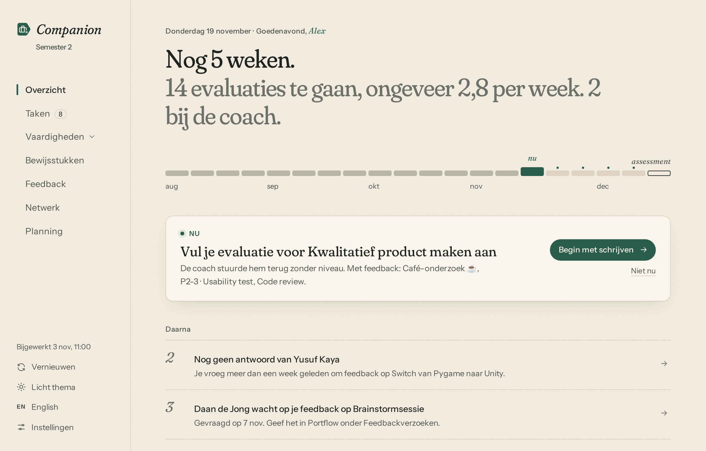
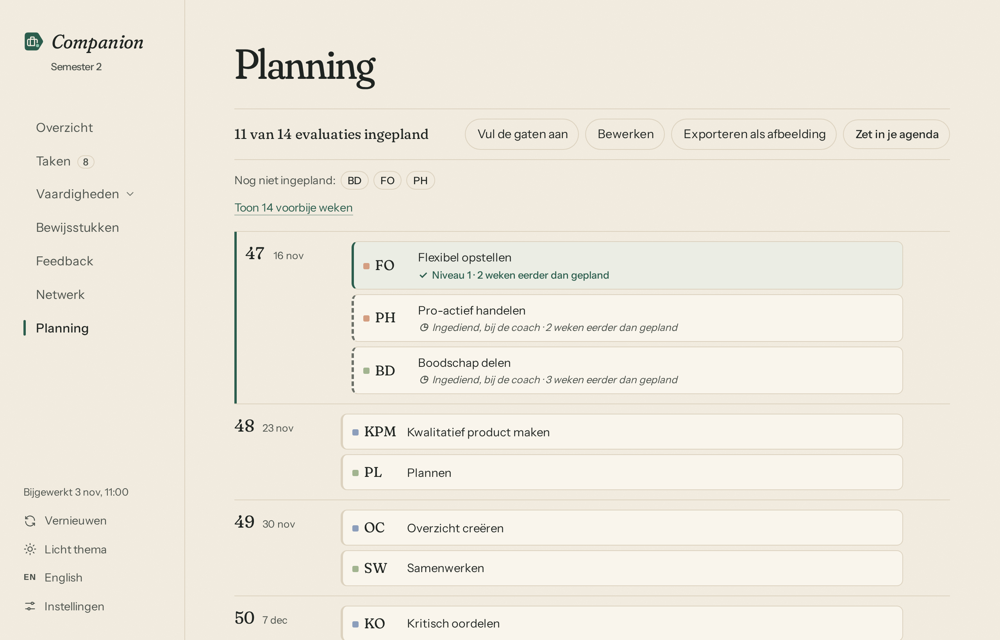

# Portflow Companion

Voor HU Open-ICT-studenten die Portflow gebruiken. Portflow toont je evaluaties en bewijsstukken los van elkaar. Wat je er niet makkelijk in ziet: waar je staat over het hele semester, wat je deze week moet doen, en of een evaluatie klaar is om in te dienen. Companion haalt je portfolio op naar je eigen computer (of je eigen server) en laat dat wel zien.

Companion is een project van een student. Het is niet verbonden aan, goedgekeurd door of gelieerd met Hogeschool Utrecht of Drieam.

*[English below.](#in-english)*

De schermafbeeldingen tonen een nepportfolio uit de demomodus.

## Wat je ermee kunt

Je ziet per vaardigheid welk niveau je coach gaf, hoeveel evaluaties je nog moet doen en hoeveel weken je daarvoor hebt. Taken zeggen wat er nu moet gebeuren, en wijzen altijd naar iets concreets: een evaluatie die te laat is, bewijs zonder feedback, een klasgenoot die op je feedback wacht.



Je plant welke evaluatie je in welke week schrijft, en maakt daar elke week een afbeelding van voor PL. Tijdens het schrijven staan de LEF-criteria, de vorige opmerking van je coach en de feedback op je bewijs ernaast. Voor een mondelinge evaluatie zet je je bewijs op volgorde en presenteer je vanuit Companion.



Op een [server](SERVER.md) haalt Companion ook op als je laptop dicht is, en krijg je meldingen op je telefoon.

## Je gegevens

Alles staat op je eigen computer, of op je server. Companion leest uit Portflow en verandert daar niets, behalve namen van bewijsstukken als jij dat bevestigt. Er wordt nooit iets verwijderd. Je Canvas-cookies gaan nergens anders heen.

Alleen wat je zelf meldt via **Idee of probleem** gaat naar de maker, en je ziet eerst wat er verstuurd wordt.

## Installeren

Je hebt [Docker Desktop](https://www.docker.com/products/docker-desktop/) nodig (Windows, macOS) of Docker (Linux). Plak daarna dit in een terminal (Windows: PowerShell) en ga naar <http://localhost:8000>:

```sh
docker run -d --name portflow-companion --restart unless-stopped -p 127.0.0.1:8000:8000 -v portflow-companion:/data ghcr.io/ldideric/portflow-companion:latest
```

Bijwerken, stoppen, verwijderen, docker compose en wat je doet als het niet werkt: [INSTALL.md](INSTALL.md). Op een server die altijd aan staat: [SERVER.md](SERVER.md).

## Companion Login

Companion logt in met je Canvas-cookies, en die verlopen meestal na ongeveer een dag. Companion Login is een klein programma dat Canvas in een eigen venster opent en je sessie aan Companion op je computer geeft, zodat opnieuw inloggen één klik is. Het werkt met Companion op je eigen computer, niet op een server. Downloaden en installeren: [INSTALL.md](INSTALL.md#inloggen-met-companion-login). De code staat in [`login/`](login/), zodat iedereen kan nagaan wat het met je login doet.

## Nieuwe versies

Wat er per versie veranderd is staat bij [Releases](../../releases). Companion zegt het zelf als er een nieuwe versie is, en laat na het bijwerken zien wat er nieuw is.

De code van Companion zelf is niet openbaar. Problemen en ideeën meld je in de app via **Idee of probleem**. Lukt het installeren niet, meld het dan via <https://companion.lietze.nl/melden>.

## Licentie en beveiliging

De code in deze repository valt onder de [Apache-2.0-licentie](LICENSE). Een beveiligingsprobleem meld je zoals in [SECURITY.md](SECURITY.md) staat, niet in een openbare issue.

## In English

Companion is a local web app for HU Open-ICT students who use Portflow. It shows where you stand this semester and what to do this week, and helps you plan, write and present your evals. It changes nothing in Portflow except evidence names you confirm. The app is in Dutch by default; the language button in the sidebar switches it to English. Install it with the `docker run` command above. The guides are in Dutch.
